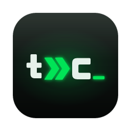

<p align="center">
  
</p>

<h1 align="center">termCode</h1>

<p align="center">
  Una terminal de escritorio hecha para trabajar con agentes de IA.<br />
  <sub>by CODERGENIUS MX</sub>
</p>

---

termCode es una terminal para macOS y Windows (Tauri + React + xterm.js) pensada para llevar varios agentes a la vez (Claude Code y Codex CLI) sin perder de vista tu repo: ves qué hace cada agente, apruebas sus permisos sin cambiar de panel, revisas sus cambios línea por línea y comparas soluciones en paralelo.

## Funciones

### Agentes
- **Mission Control** (`⇧⌘A`): todos los agentes abiertos con su estado en vivo (trabajando, te necesita, esperando), modelo, contexto usado y costo de la sesión.
- **Bandeja de aprobaciones**: los permisos que pide Claude Code aparecen abajo a la derecha, estés donde estés, con el comando o el diff completos. Si estás mirando el panel del agente, pregunta el panel, como siempre.
- **Ir al que te necesita** (`⌘J`): salta al agente bloqueado que más lleva esperando.
- **Reanudar tras reiniciar**: los paneles de agente vuelven como shells con un aviso para retomar la conversación (`claude --resume`, `codex resume --last`). Nunca se relanzan solos, para no gastar cuota.
- **Revisar cambios**: el diff de todo lo que tocó el agente desde tu último mensaje o en toda la sesión, con *Revertir* por fragmento.
- **Revisión que vuelve al agente**: comenta líneas del diff y *Enviar revisión* pega los comentarios en el agente (`archivo:línea` + la línea citada). No pulsa Enter: el mensaje lo mandas tú.
- **Carrera de agentes**: la misma tarea a varios agentes, cada uno en su worktree. Opcionalmente un *juez* (p. ej. `pnpm test`) corre en cada worktree al terminar cada turno, de uno en uno; luego aplicas el ganador y descartas el resto.
- **Los agentes leen tus otros paneles**: herramientas MCP de solo lectura (`list_panes`, `read_pane`) para "mira el error del servidor de desarrollo".
- **Consumo**: la ventana de 5 h en un anillo doble (lo usado contra el tiempo transcurrido) con la proyección de tu ritmo ("se agota a las 15:42"), barras por semana y la actividad de tokens por hora de las últimas 24 h.

### Terminal
- Paneles divisibles, maximizables y reordenables. La sesión (pestañas, divisiones y carpetas) se restaura al volver a abrir.
- Integración con zsh (macOS) y PowerShell (Windows): marcas de comando con estado y duración, `⌘↑`/`⌘↓` entre comandos, aviso cuando termina un comando largo, carpeta en vivo.
- `⌘`-clic (`Ctrl`-clic en Windows) en rutas (`src/app.ts:42`, `C:\repo\app.ts:42`) para abrirlas en tu editor (Cursor, VS Code, Zed, Sublime) o en el visor de termCode.
- Imágenes en línea (sixel e iTerm2), búsqueda, barras de progreso (OSC 9;4) y broadcast a todos los paneles.
- **Terminal rápida**: baja sobre cualquier app con un atajo global (`Alt+Space` en macOS y `Ctrl+Alt+Space` en Windows por defecto, porque allí `Alt+Space` abre el menú de la ventana).
- **Bienvenida**: cada shell nueva (pestaña, división o rápida) y cada `clear` muestran el logo, tus agentes, tu cuota y los atajos principales. Es una tarjeta anclada a la terminal: no se deforma al dividir y puedes desactivarla.

### Git y proyecto
- Cambios con diff unificado o lado a lado; preparar, descartar o revertir por fragmento.
- Commits con mensaje generado por Claude Code (`claude -p`), amend, push y pull.
- Historial, ramas (`⇧⌘B`), stash, resolución de conflictos bloque a bloque.
- Pull requests y estado de CI con `gh`.
- Buscador de archivos (`⌘P`), explorador y visor/editor (CodeMirror) con imágenes.

### Interfaz
- Temas **Neón** (por defecto, con el verde del logo), **Fósforo**, **Fósforo verde** y **Papel** (claro).
- Glass real en macOS: la ventana usa vibrancy y los diálogos son vidrio esmerilado. Con *Reducir transparencia* activado en el sistema, todo se pinta opaco. En Windows la ventana es opaca y usa la barra de título del sistema (con Snap Layouts).
- Paleta de comandos (`⌘K`) con todas las acciones, y la hoja de atajos al mantener `⌘` medio segundo.
- Actualizaciones firmadas desde Ajustes → Acerca de (en las compilaciones que las tienen configuradas).

## Atajos

En macOS el modificador es `⌘`; en Windows, `Ctrl+Shift`, y donde macOS suma `⇧` o `⌥`, Windows suma `Alt` (`⇧⌘D` es `Ctrl+Shift+Alt+D`). Todos están en la paleta (`⌘K` / `Ctrl+Shift+K`), escritos con las teclas de tu sistema.

| Atajo | Acción | Atajo | Acción |
|---|---|---|---|
| `⌘K` | Paleta de comandos | `⇧⌘A` | Mission Control |
| `⌘T` | Pestaña nueva | `⌘J` | Ir al agente que te necesita |
| `⌘D` / `⇧⌘D` | Dividir a la derecha / abajo | `⌘U` | Consumo de IA |
| `⌥⌘←` / `⌥⌘→` | Panel anterior / siguiente | `⌘P` | Buscar archivo |
| `⇧⌘↵` | Maximizar panel | `⇧⌘G` | Cambios y commit |
| `⌘W` | Cerrar panel | `⇧⌘E` | Archivos del proyecto |
| `⇧⌘T` | Reabrir lo cerrado | `⇧⌘B` | Cambiar de rama |
| `⇧⌘O` | Ver todos los paneles | `⌘F` | Buscar en el panel |
| `⌘↑` / `⌘↓` | Comando anterior / siguiente | `⇧⌘I` | Broadcast |
| `⌘1`…`⌘9` | Ir a la pestaña | `⌘,` | Ajustes |
| `⌘B` | Barra lateral | `⌘+` / `⌘−` / `⌘0` | Tamaño de letra |

## Requisitos

- macOS, o Windows 10 1809 o posterior (la primera versión con ConPTY). En Windows hace falta WebView2, que ya viene en Windows 11 y que el instalador descarga si falta.
- [Node.js](https://nodejs.org) 22 o superior y [pnpm](https://pnpm.io) 12.
- [Rust](https://rustup.rs) estable con edición 2024 (1.85 o superior).
- Opcional: [Claude Code](https://code.claude.com/docs) (`npm install -g @anthropic-ai/claude-code`), [Codex CLI](https://github.com/openai/codex) (`npm install -g @openai/codex`) y [GitHub CLI](https://cli.github.com) (`gh`) para PRs y CI.

## Desarrollo

```bash
pnpm install
pnpm tauri dev      # la app de escritorio con recarga en caliente
```

| Comando | Qué hace |
|---|---|
| `pnpm check` | Typecheck, lint y tests unitarios (Vitest) |
| `pnpm e2e` | Pruebas de punta a punta en Chrome headless (`pnpm e2e -- <nombre>` para una sola) |
| `cargo test --workspace` | Tests de Rust |
| `cargo clippy --workspace --all-targets -- -D warnings` | Lint de Rust, igual que en CI |
| `pnpm tauri build` | App empaquetada (`.app` y `.dmg` en macOS; `.exe` de NSIS y `.msi` en Windows) |

Las e2e no necesitan dependencias: `e2e/run.mjs` levanta Vite, abre Chrome por CDP y simula el backend reemplazando funciones de la página. Si fallan, dejan capturas en `e2e/artifacts/`.

### Estructura

```
src/                 Interfaz (React 19, Tailwind v4, zustand)
  components/        Barra lateral, pestañas, paneles, Mission Control, visor…
  lib/               Acciones, puente con el backend, git, cuotas, revisión…
  store/             Estado (terminales, proyecto, ajustes, aprobaciones, carreras)
  terminal/          xterm.js: gestor de terminales, integración con la shell
src-tauri/           Backend (Rust, Tauri 2)
  src/agents.rs      Hooks y statusLine de Claude Code, detección de herramientas
  src/approvals.rs   Bandeja de aprobaciones (hook PermissionRequest)
  src/mcp.rs         Servidor MCP de solo lectura y socket local
  src/git/           Estado, diffs, ramas, worktrees, PRs, CI, mensajes con IA
  src/usage/         Cuotas y tokens de Claude y Codex
crates/pty-core/     PTYs con backpressure (el proceso se frena antes de saturar la vista)
e2e/                 Pruebas de punta a punta
```

### CI y releases

- **CI** (`.github/workflows/ci.yml`): frontend en Ubuntu (typecheck, lint, tests, build), e2e en macOS, Rust en macOS (fmt, clippy, tests y un benchmark del PTY) y un job en Windows (tests del frontend, build, clippy y tests de Rust) para que un `cfg(unix)` mal puesto no rompa esa versión sin que nadie se entere.
- **Release** (`.github/workflows/release.yml`): `git tag v0.2.0 && git push --tags` genera un borrador de release con el `.dmg` universal y los instaladores de Windows. Los archivos no llevan la versión en el nombre, así que `releases/latest/download/termCode_universal.dmg` y `releases/latest/download/termCode_x64-setup.exe` siempre bajan la última versión publicada. La firma y notarización de Apple dependen de los secretos `APPLE_*` (sin ellos el `.app` se firma ad hoc y Gatekeeper pide abrirlo desde Privacidad y seguridad); las actualizaciones automáticas, de `TAURI_SIGNING_PRIVATE_KEY` y `TAURI_UPDATER_PUBKEY`. El instalador de Windows sale sin firma Authenticode (SmartScreen avisará) hasta configurar un firmador en `bundle.windows.signCommand`, por ejemplo Azure Trusted Signing: los certificados nuevos viven en un HSM y ya no caben en un `.pfx` dentro de un secreto.

### Windows

- **Shell**: PowerShell 7 (`pwsh`) si está instalado; si no, Windows PowerShell 5.1. La integración se carga después de tu perfil y no lo modifica. Funciona con la política de ejecución por defecto (`Restricted`) porque no se ejecuta como archivo `.ps1`. Necesita PSReadLine (viene con Windows) para las marcas de comando; sin él quedan el prompt y la carpeta.
- **Agentes**: se lanzan sin `cmd.exe`, que interpretaría `%`, `&` o comillas de tu prompt. termCode busca el ejecutable real (el instalador nativo de Claude Code deja `claude.exe` en `%USERPROFILE%\.local\bin`; los shims `.cmd` de npm, pnpm y yarn se siguen hasta su `.exe` o su script de Node) y PowerShell lo inicia con los argumentos ya citados. Si un shim no se puede seguir, solo se lanza con texto que `cmd.exe` no pueda malinterpretar.
- **Claude Code**: los hooks usan la forma exec (sin shell). El statusLine lo corre Git Bash si está instalado y, si no, PowerShell; termCode escribe la ruta de forma que valga para los dos.
- **Pendiente de probar en un Windows real**: todo lo anterior está cubierto por tests y por el lint de Windows en CI, pero el comportamiento en ejecución (ConPTY, la named pipe de las aprobaciones, la integración con PowerShell) no se ha probado a mano todavía. Reporta lo que falle.

## Privacidad y seguridad

- **Nada en `~/.claude` se modifica.** Los hooks, el statusLine y el MCP de termCode solo se aplican a las sesiones de Claude Code que abres desde termCode (`--settings` y `--mcp-config` en la línea de comandos).
- **Cuotas de Claude**: el token de acceso se lee de donde lo guarda Claude Code (el Llavero en macOS, con `/usr/bin/security`; `%USERPROFILE%\.claude\.credentials.json` en Windows), para una sola petición a `api.anthropic.com/api/oauth/usage`. Es un endpoint no documentado, así que puede cambiar. El token nunca se guarda en disco, nunca se registra, nunca llega a la interfaz y nunca se refresca (refrescarlo cerraría tu sesión de Claude Code).
- **Tokens y actividad**: se cuentan leyendo localmente los registros de Claude Code (`~/.claude/projects`) y de Codex (`~/.codex`). No sale nada a la red.
- **Aprobaciones**: ante cualquier fallo (app cerrada, tiempo agotado, respuesta inválida), Claude pregunta en su panel. Nunca se aprueba nada por omisión y nunca se recorta lo que apruebas.
- **MCP y aprobaciones**: el canal local es un socket Unix con permisos `0600` (macOS) o una named pipe que solo abre tu usuario y rechaza clientes remotos (Windows). El MCP es de solo lectura y se desactiva en Ajustes → Agentes.
- **Pegar en un agente** (revisiones, salidas): se quitan los caracteres de control, para que un texto con `ESC[201~` no pueda salirse del pegado y ejecutar comandos.
- **Portapapeles**: los programas pueden escribir en él (OSC 52), nunca leerlo.
- **Commits con IA**: `claude -p` con Haiku, sin herramientas (`--tools ""`), sin tu `CLAUDE.md` global y sin guardar transcripciones. Solo se ejecuta cuando pulsas el botón.
- **Glass**: la ventana transparente usa `macOSPrivateApi` de Tauri. Por eso termCode no puede distribuirse en la Mac App Store (se distribuye con su propio `.dmg` y actualizador).

## Licencia

[MIT](LICENSE) © 2026 Jorge Torres. Puedes usar, modificar y redistribuir termCode, también en proyectos comerciales, siempre que conserves el aviso de copyright y la licencia.
